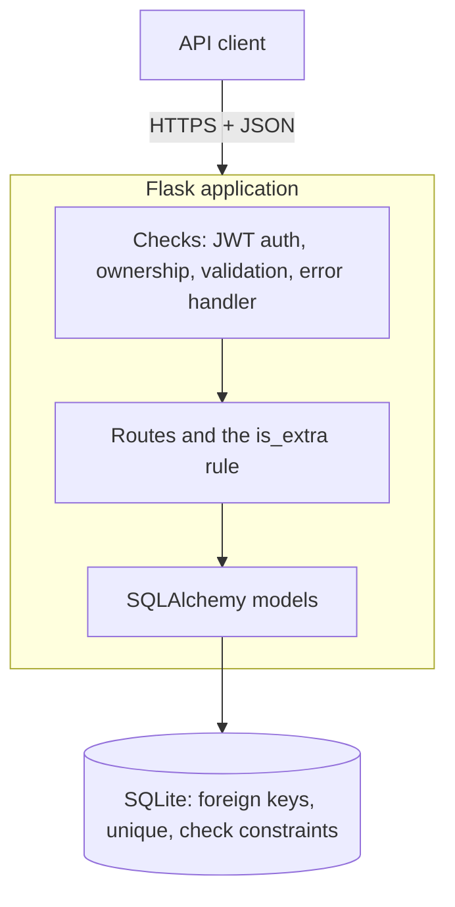

# RevisionTrack

A small REST API for freelancers to log client revision requests against projects and flag the ones that go over the agreed limit. Each freelancer has an account and only sees their own clients, projects and requests.

- **Stack:** Python, Flask, Flask-SQLAlchemy, SQLite, Pydantic, JWT (Flask-JWT-Extended), bcrypt, Flask-Limiter, Flask-Cors, pytest
- **Docs:** see the `docs/` folder (idea one-pager, work plan, ERD, API spec, issue log)
- **All data is dummy data.** Never put real personal data or passwords in this project.

## Live API
`https://revision-track.onrender.com`

Hosted on a free tier: the service sleeps after about 15 minutes of inactivity, so the first request may take up to a minute. The database is reset to the dummy data whenever the service restarts.

## The Problem
An independent freelancer (designer, developer, writer) agrees a fixed number of revisions with each client. Clients keep asking for "one small change", and the freelancer loses track of how many revisions were agreed, how many were used, and which ones should have been billed as extra.
 
RevisionTrack records every revision request against a project. The server marks a request as **extra** when the project has already used its agreed revisions (rejected requests do not count), so scope creep becomes visible and billable.

## How to run

```bash
python -m venv venv
source venv/bin/activate              # Windows: venv\Scripts\activate
pip install -r requirements.txt
cp .env.example .env                  # Windows: copy .env.example .env
```
 
Open `.env` and replace `JWT_SECRET_KEY` with your own random value (the app refuses to start without one):
 
```bash
python -c "import secrets; print(secrets.token_hex(32))"
```
 
```bash
python seed.py                        # resets the database and loads dummy data
flask run                             # API at http://localhost:5000
```
 
Then open **http://localhost:5000/docs** for the interactive API documentation, and log in with a demo account:
 
| Email | Password |
|---|---|
| demo@example.com | Password123! |
| second@example.com | Password123! |

## Using the API

```bash
# 1. log in and copy the access_token from the response
curl -X POST http://localhost:5000/auth/login -H "Content-Type: application/json" \
  -d '{"email": "demo@example.com", "password": "Password123!"}'
 
# 2. send it on every other request
curl http://localhost:5000/projects -H "Authorization: Bearer <access_token>"
```
`requests.http` has a sample request for every endpoint, including the error cases (VS Code "REST Client" extension).

| Status | Meaning |
|---|---|
| 401 | Not logged in, or the token is missing, invalid or expired |
| 403 | The record exists but belongs to another user |
| 404 | The record does not exist (or the URL is wrong) |
| 400 | Invalid input |
| 409 | Duplicate (username, user email, or the same client email twice for one user) |


## Endpoints

| Method | Path | Purpose |
|---|---|---|
| POST | `/auth/register` | Create an account |
| POST | `/auth/login` | Log in and get a token |
| GET, POST | `/clients` | List or create your clients |
| GET, PATCH, DELETE | `/clients/{id}` | Get, update or delete a client (its projects are kept) |
| GET | `/clients/{id}/projects` | A client's projects |
| GET, POST | `/projects` | List or create your projects |
| GET, PATCH, DELETE | `/projects/{id}` | Get, update or delete a project (its revision requests are deleted too) |
| POST | `/projects/{project_id}/revision-requests` | Log a revision request (the server sets `is_extra`) |
| GET | `/projects/{project_id}/revision-requests` | List a project's requests, optional `?status=` |
| GET, PATCH, DELETE | `/revision-requests/{id}` | Get, update or delete a request |

Every endpoint except register and login needs `Authorization: Bearer <token>`. List endpoints accept `?page=` and `?per_page=` (default 20, maximum 100). Full details, validation rules and design decisions are in `docs/api-spec.md`.

Errors always look like `{ "error": { "code": "NOT_FOUND", "message": "..." } }`.
 
## Running the tests
```bash
pip install -r requirements-dev.txt
pytest
```
The tests use an in-memory database and never touch your real data. Add coverage with `pytest --cov --cov-report=term-missing`. What is and is not tested is in [`docs/test-notes.md`](docs/test-notes.md).
 
## Data model

 
- A user owns many clients and many projects.
- A client has many projects. A project has zero or one client.
- A project has many revision requests. A request is owned through its project.
- Deleting a client keeps its projects (their `client_id` becomes empty). Deleting a project deletes its requests.
## Architecture
A layered monolith: one Flask app, one SQLite database, and the same pipeline for every request.
 

 
| File | Job |
|---|---|
| `app.py` | Routes, authentication, ownership checks, pagination, error handling |
| `schemas.py` | Validation and sanitisation of every request body |
| `models.py` | Tables, relationships, indexes and delete rules |
| `seed.py` | Resets the database and loads dummy data |
| `docs/openapi.yaml` | The API contract (a test checks it matches the real routes) |
| `tests/` | The test suite |
 
## Key decisions
- **Revision requests carry the core logic.** The `is_extra` flag is set only by the server, so it cannot be faked.
- **Rejected requests do not count** toward the agreed limit, because they were never carried out.
- **A relational database.** The data is relational and the database itself enforces foreign keys, delete rules, unique values and a non-negative limit.
- **Projects outlive clients,** so work history is not lost when a client relationship ends.
- **Stateless JWT login with bcrypt.** Simple and scalable, but tokens cannot be revoked, so they expire after 1 hour.
- **Ownership is checked in code,** because the database cannot know that a client and a project belong to the same user. Everything else the database can enforce, it does.
- **One error format and one global error handler,** so clients never see a stack trace.
The full list, with trade-offs, is in `docs/api-spec.md`. Bugs found and how they were fixed are in [`docs/issue-log.md`](docs/issue-log.md).
 
## Security and performance
Short notes are in [`docs/security-and-performance.md`](docs/security-and-performance.md). In brief: secrets only in environment variables, bcrypt password hashing, input validation and sanitisation, rate limits on login and register, CORS closed unless configured, pagination on every list, and indexes on the fields queries filter by.
 
## Deploying (Render, free tier)
The repo includes a `render.yaml` blueprint.
1. Push the repo to GitHub.
2. In Render choose **New**, then **Blueprint**, pick the repo and apply. Render generates a random `JWT_SECRET_KEY` for you.
3. When the deploy finishes, open `<your-service>.onrender.com/docs`.
4. Replace the live link in this README and the `servers` address in `docs/openapi.yaml`.
Without the blueprint, create a **Web Service** with: build command `pip install -r requirements.txt`; start command `python seed.py && gunicorn app:app --bind 0.0.0.0:$PORT --workers 1 --threads 4`; environment variables `JWT_SECRET_KEY` (a random value), `FLASK_DEBUG=0`, `BEHIND_PROXY=1` and `PYTHON_VERSION=3.11.9`.
 
## Limitations
- SQLite on a free host is wiped on restart, so the live data resets (fine for dummy data, not for real use). A real deployment would use PostgreSQL.
- The schema is created directly and there are no migrations yet.
- The `is_extra` check and the insert are separate steps, so two simultaneous requests could both read the same count.
- The rate limiter keeps its counters in memory, so it works per process (hence one worker).
- Tokens cannot be revoked before they expire, and there is no logout, refresh or password reset.
- A 403 confirms that a record exists (the work guide asks for 403).
## Declaration
See [`docs/reflection-and-declaration.md`](docs/reflection-and-declaration.md) for the technical reflection and the declaration of my own work, libraries used and AI use.
