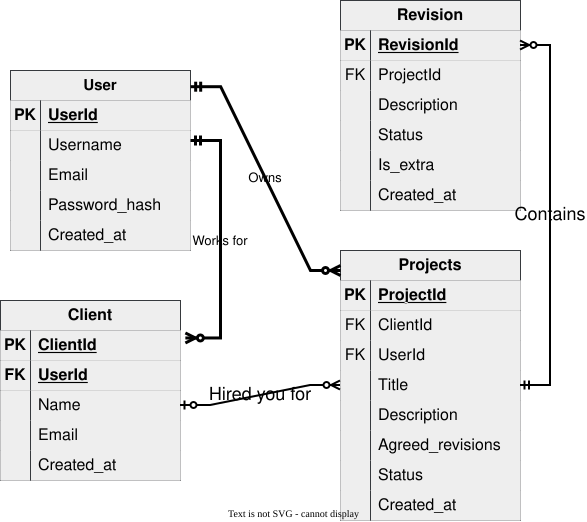

# RevisionTrack: Data model and API spec (Week 1)

**GitHub Repo:** https://github.com/maj-alero/revision-track

## 1. Entities

Table and column definitions match models.py.

**users**
| Field | Type | Notes |
|---|---|---|
| id | integer | Primary key |
| username | string (max 150) | Required, unique |
| email | string (max 150) | Required, unique, stored in lowercase |
| password_hash | string (max 255) | bcrypt hash, never returned by the API |
| created_at | datetime | Set by the server |

**clients**
| Field | Type | Notes |
|---|---|---|
| id | integer | Primary key |
| user_id | integer | Foreign key to users.id, required, ON DELETE CASCADE (the owner) |
| name | string (max 150) | Required |
| email | string (max 150) | Required, unique per user (a user cannot add the same client email twice) |
| created_at | datetime | Set by the server |

**projects**
| Field | Type | Notes |
|---|---|---|
| id | integer | Primary key |
| user_id | integer | Foreign key to users.id, required, ON DELETE CASCADE (the owner) |
| client_id | integer | Foreign key to clients.id, nullable, ON DELETE SET NULL |
| title | string (max 150) | Required |
| description | text | Optional |
| agreed_revisions | integer | Required, default 0, must be 0 or more (database check constraint) |
| status | string | Active (default), Completed or On-hold |
| created_at | datetime | Set by the server |

**revision_requests** (model class RevisionRequest)
| Field | Type | Notes |
|---|---|---|
| id | integer | Primary key |
| project_id | integer | Foreign key to projects.id, required, ON DELETE CASCADE, not editable after creation |
| description | text | Required, non-empty (the API limits it to 500 characters) |
| status | string | Pending (default), Completed or Rejected |
| is_extra | boolean | Default false, set by the server on creation, never accepted from the client |
| created_at | datetime | Set by the server |

## 2. ERD



Relationships
- One user owns many clients and many projects.
- One client has many projects. A project has zero or one client (the link becomes empty if the client is deleted).
- One project has many revision requests. A revision request belongs to exactly one project.
- A revision request is owned by whoever owns its project (it has no user_id of its own).

Delete rules (enforced by the database, with SQLite foreign keys switched on)
- Deleting a client keeps its projects; their client_id becomes NULL.
- Deleting a project deletes its revision requests.
- Deleting a user deletes their clients and projects (there is no endpoint for this yet).

## 3. Authentication

- Register with POST /auth/register, then log in with POST /auth/login to receive an access token.
- Send the token on every other request in the header: `Authorization: Bearer <access_token>`.
- Tokens last 1 hour. There is no refresh or logout endpoint.
- Passwords are hashed with bcrypt and are never stored, returned or logged in plain text.
- Every endpoint except /auth/register and /auth/login needs a valid token.

## 4. Endpoints

All request and response bodies are JSON. Every error uses one format:

```json
{ "error": { "code": "NOT_FOUND", "message": "Project 99 not found" } }
```

### Auth

| Method | Path | Purpose | Request body | Responses |
|---|---|---|---|---|
| POST | /auth/register | Create an account | `{ "username", "email", "password" }` | 201: the new user (id, username, email, created_at); 400: invalid input; 409: username or email already registered |
| POST | /auth/login | Log in | `{ "email", "password" }` | 200: `{ "access_token", "token_type": "Bearer" }`; 400: invalid input; 401: invalid email or password |

### Clients

| Method | Path | Purpose | Request body | Responses |
|---|---|---|---|---|
| POST | /clients | Create a client | `{ "name", "email" }` | 201: the client; 400; 401; 409: you already have a client with this email |
| GET | /clients | List your clients | none | 200: array; 401 |
| GET | /clients/{id} | Get one client | none | 200; 401; 403; 404 |
| PATCH | /clients/{id} | Update a client | `{ "name"?, "email"? }` | 200: the updated client; 400; 401; 403; 404; 409 |
| DELETE | /clients/{id} | Delete a client (its projects are kept) | none | 204; 401; 403; 404 |
| GET | /clients/{id}/projects | List a client's projects | none | 200: array; 401; 403; 404 |

### Projects

| Method | Path | Purpose | Request body | Responses |
|---|---|---|---|---|
| POST | /projects | Create a project | `{ "title", "agreed_revisions", "description"?, "client_id"?, "status"? }` | 201: the project; 400 (including a client_id that is not yours); 401 |
| GET | /projects | List your projects | none | 200: array; 401 |
| GET | /projects/{id} | Get one project | none | 200; 401; 403; 404 |
| PATCH | /projects/{id} | Update a project | any of `title`, `description`, `client_id`, `agreed_revisions`, `status` | 200: the updated project; 400; 401; 403; 404 |
| DELETE | /projects/{id} | Delete a project (its revision requests are deleted too) | none | 204; 401; 403; 404 |

### Revision requests

| Method | Path | Purpose | Request body | Responses |
|---|---|---|---|---|
| POST | /projects/{project_id}/revision-requests | Log a request under a project; the server sets is_extra | `{ "description" }` | 201: the request; 400; 401; 403; 404 |
| GET | /projects/{project_id}/revision-requests | List a project's requests; optional `?status=Pending`, `Completed` or `Rejected` | none | 200: array; 400 (invalid status filter); 401; 403; 404 |
| GET | /revision-requests/{id} | Get one request | none | 200; 401; 403; 404 |
| PATCH | /revision-requests/{id} | Update description and/or status | `{ "description"?, "status"? }` | 200: the updated request; 400; 401; 403; 404 |
| DELETE | /revision-requests/{id} | Delete a request | none | 204; 401; 403; 404 |

Example responses

```json
{ "id": 4, "project_id": 1, "description": "Make the logo bigger", "status": "Pending", "is_extra": false, "created_at": "2026-10-13T10:15:00" }
```

```json
{ "id": 1, "title": "Bakery logo redesign", "description": "New logo and colour palette", "client_id": 1, "agreed_revisions": 3, "status": "Active", "created_at": "2026-10-01T09:00:00" }
```

client_id is null for a project whose client was deleted. IDs in URLs that are not positive whole numbers, or are too large for the database, return 404.

## 5. Status codes and error codes

| Status | Error code | When |
|---|---|---|
| 400 | VALIDATION_ERROR | Invalid or missing input, unknown fields, a status or filter that is not allowed, a client_id that is not yours |
| 401 | UNAUTHORIZED | No token, an invalid token, or wrong login details |
| 401 | TOKEN_EXPIRED | The token has expired, log in again |
| 403 | FORBIDDEN | The record exists but belongs to another user |
| 404 | NOT_FOUND | The record does not exist, or the URL or ID is invalid |
| 405 | METHOD_NOT_ALLOWED | The method is not supported for that URL |
| 409 | CONFLICT | Duplicate username or email at registration, or the same client email twice for one user |
| 500 | INTERNAL_ERROR | Unexpected server error. The message is generic and the details stay in the server log. |

Checks run in this order: token (401), record exists (404), record is yours (403), then the request body (400).

## 6. Business rule: is_extra

When a revision request is created, the server counts the project's existing requests whose status is not Rejected. If that count is already greater than or equal to agreed_revisions, the new request is saved with is_extra = true; otherwise false.

Examples with agreed_revisions = 3:
- 0, 1 or 2 existing requests: the new request is not extra
- 3 or more existing requests: the new request is extra

is_extra cannot be set or changed through the API. Changing a request's status or a project's agreed_revisions later does not recompute flags already saved (a documented limitation).

## 7. Validation rules

Every request body is validated with Pydantic.
- Unknown fields are rejected with 400, so nobody can send user_id, project_id or is_extra.
- Text is trimmed. Emails are trimmed and lowercased and must look like an email address.
- username: 3 to 150 characters. password: 8 to 72 characters. client name and project title: 1 to 150 characters. project description: up to 2000 characters. revision description: 1 to 500 characters, not only spaces.
- agreed_revisions: a whole number from 0 to 1000. IDs in bodies must be whole numbers from 1 up. Strings such as "3" and values such as true are not accepted for numbers.
- status values are case-sensitive: Active, Completed, On-hold for projects and Pending, Completed, Rejected for revision requests.
- PATCH needs at least one field. null is only allowed for a project's description and client_id (to clear them).
- The ?status= filter is checked against the allowed values, and anything else returns 400.
- SQLite does not enforce enum values, so this validation is the guard.

## 8. Seed data

Dummy data only. Two users (demo@example.com and second@example.com, both with the dummy password Password123!), each with their own clients, projects and revision requests, including a project already over its limit, a Rejected request, and a project with no client. The seed script resets the database each time it runs. The second user exists so ownership checks (403) can be demonstrated.

## 9. Design decisions

- **Main entity is revision_requests.** It holds the app's core value (the extra-revision flag), so full CRUD there demonstrates the real purpose. Clients and projects are seeded.
- **Rejected requests do not count toward the limit.** A rejected request was never carried out, so it should not use up the client's agreed revisions.
- **Server-side `is_extra`.** Computing it on the server prevents clients from faking or hiding extra work.
- **A relational (SQL) database instead of NoSQL.** The data is naturally relational: a client has many projects, and a project has many revision requests, with a fixed set of fields on each. A relational database lets the database itself enforce the rules the app depends on: foreign keys stop a request pointing at a missing project, `ON DELETE SET NULL` and `CASCADE` define what happens on deletes, `UNIQUE` prevents duplicate client emails, and a check constraint blocks a negative revision limit. The core feature, deciding `is_extra`, is a simple count of a project's non-rejected requests, which SQL does directly. A document database such as MongoDB suits data whose shape varies between records or that must scale across many servers, and neither applies here. In NoSQL, the links between clients, projects and requests, and the delete rules, would have to be enforced in application code. The trade-off is that changing the schema needs migrations. 
- **SQLite for Week 1.** Anyone can clone and run the project with no database install. The database location comes from `DATABASE_URL`, so switching to PostgreSQL for deployment is a configuration change. Foreign keys are switched on explicitly for every connection because SQLite ignores them by default.
- **Projects outlive clients.** `projects.client_id` is nullable with `ON DELETE SET NULL`, so work history is preserved when a client is deleted. Client deletion endpoints arrive in Week 2.
- **A project's revision requests are deleted with it.** A request has no meaning without its project, so `project_id` is required and uses `ON DELETE CASCADE`.
- **Database-level safety nets.** `agreed_revisions >= 0` is a check constraint, and `clients.email` is unique, so bad data is rejected even if it bypasses the API.
- **No ORM relationships in Week 1.** Foreign keys alone link the tables; queries filter by `project_id` directly.